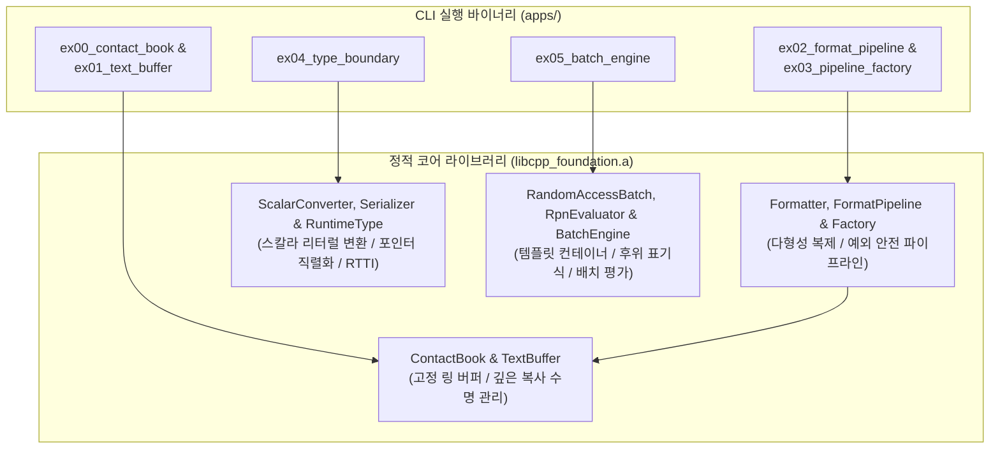

<p align="center">
  <h1 align="center">cpp-foundation</h1>
  <p align="center"><b>객체 수명, 복사 대입, 다형성, 형 변환, 템플릿과 예외 안전성을 다루는 C++98 정적 라이브러리 및 6종 CLI 실행기</b></p>
  <p align="center">
    
    
  </p>
</p>

42 `CPP00`-`CPP09` 과제를 변형한 C++98 프로젝트입니다. 객체 수명, 복사 대입, 다형성, 형 변환, 템플릿과 예외 안전성을 다루는 정적 라이브러리와 그 라이브러리를 쓰는 예제 프로그램 6개를 만듭니다.

## 아키텍처와 핵심 설계



- **C++98 결정론적 수명 관리(Orthodox Canonical Form)와 예외 안전성**: C++11 이동 의미론이나 스마트 포인터 없이 `-std=c++98 -pedantic-errors` 제약 아래에서 동적 자원을 직접 관리합니다. `TextBuffer`와 `FormatPipeline`은 깊은 복사 생성자와 예외를 던지지 않는 `swap() throw()` 기반 Copy-and-Swap 대입 연산자로 자기 대입을 방어하며, `FormatPipeline` 복사 중이나 `PipelineBuilder::replace`, `BatchEngine::replace` 실행 중에 예외가 발생하더라도 이미 할당된 단계만 정리하고 기존 대상 객체의 상태를 그대로 유지하는 강한 예외 안전성(Strong Exception Guarantee)을 보장합니다.
- **정적 코어 라이브러리(`libcpp_foundation.a`)와 6개 도메인 실행기 분리**: 고정 용량 순환 연락처(`ContactBook`)와 문자열 버퍼(`TextBuffer`), `clone()` 가상 함수를 통한 다형성 포매터 파이프라인과 팩토리(`Formatter`, `FormatPipeline`, `PipelineBuilder`), 스칼라 리터럴 파싱과 포인터 직렬화 및 동적 타입 식별(`ScalarConverter`, `Serializer`, `RuntimeInspector`), 그리고 템플릿 배치 컨테이너와 역폴란드 표기법(RPN) 계산기(`RandomAccessBatch<T>`, `RpnEvaluator`, `BatchEngine`)를 모두 `libcpp_foundation.a` 정적 아카이브에 모으고 `ex00_contact_book`부터 `ex05_batch_engine`까지 6개 CLI 실행 파일은 입출력과 인자 파싱 경계만 담당하도록 분리했습니다.
- **Sanitizer 및 심볼과 누수 검증 파이프라인(`make check`)**: 단위 테스트와 프로퍼티 및 실패 주입 테스트뿐 아니라 AddressSanitizer(`make test-asan`)와 UndefinedBehaviorSanitizer(`make test-ubsan`) 빌드를 분리해 메모리 오류와 정의되지 않은 동작을 검사합니다. `make check`는 출력 결정성 검증, 정적 아카이브(`libcpp_foundation.a`) 심볼 구성 검사(`check_archive.sh`), 바이너리 동적 의존성 검사(`check_dependencies.sh`), 외부 소비자 링크 검증(`check_external_consumer.sh`), 그리고 `leaks` 기반 런타임 메모리 누수 검사(`check_leaks.sh`)를 순차 실행합니다.

## 빌드

```sh
make
```

산출물은 `build/lib/libcpp_foundation.a`와 `build/bin/ex00_contact_book`부터 `build/bin/ex05_batch_engine`까지입니다.

## 실행

```sh
./build/bin/ex00_contact_book < tests/fixtures/contact-session.in
./build/bin/ex03_pipeline_factory mixed 'prefix=[' upper 'suffix=]'
./build/bin/ex04_type_boundary scalar 42.5
./build/bin/ex05_batch_engine rpn '3 4 +'
```

`ex00`과 `ex05 batch`는 표준 입력에서 한 줄씩 명령을 읽고, 나머지는 인자를 받습니다. 인자 없이 실행하면 각 프로그램이 usage를 출력합니다.

## 테스트

```sh
make test
```

- `make test-ubsan`, `make test-asan`: sanitizer 빌드로 단위 테스트를 실행합니다.
- `make check`: `test`에 결정성, 정적 라이브러리 구성, Mach-O 의존성, `leaks` 검사를 더합니다.

## 범위와 제한

- `-std=c++98 -pedantic-errors -Wold-style-cast`로 빌드하므로 C++11 이후 기능은 쓰지 않습니다.
- `make check`의 정적 라이브러리, 의존성, 누수 검사는 macOS에서만 동작합니다.
- `make test-asan`은 `detect_leaks=1`을 켜므로 macOS의 Apple clang에서는 실행 직후 중단됩니다.
- 예제 프로그램은 라이브러리 API를 호출해 보는 용도이며 독립된 도구가 아닙니다.
