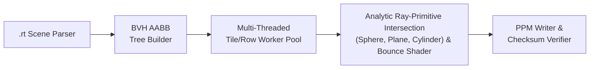

<p align="center">
  <h1 align="center">ray-scene-tracer</h1>
  <p align="center"><b>.rt 장면의 구, 평면, 유한 원기둥을 BVH 가속 구조와 멀티스레드로 레이 트레이싱해 PPM으로 저장하는 C++17 렌더러</b></p>
  <p align="center">
    
    
  </p>
</p>

42서울 내부 과제 비공개 규정에 따라 수료 후 자체 명세로 새로 설계해 공개한 C++17 프로젝트입니다. `.rt` 장면 파일을 읽어 구, 평면, 원기둥을 CPU에서 ray tracing하고 PPM 이미지로 저장합니다.

## 아키텍처와 핵심 설계



- **AABB 기반 BVH 공간 분할 가속 구조(`--accel bvh`)**: 선형 탐색(`linear`) 대비 광선과 도형의 교차 판정 횟수를 줄이기 위해 경계 상자(`Aabb`)가 정의되는 구(`Sphere`)와 유한 원기둥(`Cylinder`)으로 경계 볼륨 계층(`Bvh`) 트리를 구성하고, 경계가 무한한 평면(`Plane`)은 `unboundedIndices_`로 분리해 별도 검사합니다. 가장 긴 중심점(`centroid`) 축을 기준으로 도형을 정렬(`std::stable_sort`)해 리프 노드가 최대 4개 도형을 갖도록 이진 분할하며, 광선 추적 시 슬랩(Slab) 교차 판정으로 진입 거리(`entry`)가 가까운 자식 노드를 먼저 방문하고 현재 최단 교차 거리(`closest`)보다 먼 노드는 건너뜁니다.
- **도형별 해석적 교차 판정과 유한 원기둥 캡 처리**: 구(`sp`), 평면(`pl`), 유한 원기둥(`cy`)의 교차 방정식을 해석적으로 풀고 법선 벡터를 항상 광선 반대 방향(`setFaceNormal`)으로 정규화합니다. 특히 유한 원기둥은 축에 수직인 투영 성분으로 2차 방정식을 풀어 높이 구간(`[-height/2, height/2]`) 안의 측면 교차를 판정한 뒤, 상하단 원판 캡(`test_cylinder_cap`) 교차까지 함께 비교해 가장 가까운 지점을 선택합니다. 표면 재질에 따라 `diffuse`는 그림자 광선(`isOccluded`)을 포함한 람베르트 조명과 주변광을 합산하고, `metal`은 반사 방향 광선을 `--max-depth` 한도까지 재귀 추적합니다.
- **멀티스레드 분할 렌더링과 일관된 체크섬 검증(`--checksum`)**: 전체 화면을 `16x16` 픽셀 타일로 나누고 워커 스레드 풀이 `std::atomic<std::size_t>` 카운터(`next_tile`)에서 타일 인덱스를 하나씩 가져가 독립된 픽셀 오프셋에 기록합니다. 캐시 라인 정렬(`alignas(64)`)된 스레드별 통계와 도형 인덱스 기반 동점 처리 규칙을 두어 `--threads` 설정이나 가속 모드(`linear`와 `bvh`)가 달라져도 항상 동일한 픽셀 버퍼와 64비트 FNV-1a 체크섬(`checksumHex`)을 산출하며, PPM 파일 저장 시에는 임시 파일에 먼저 기록한 뒤 원자적으로 교체(`rename`)합니다.

## 빌드

```sh
make
```

산출물은 `build/bin/ray-scene-tracer`, `build/bin/ray-benchmark`, `build/lib/libraycore.a`입니다. Makefile은 `cmake -S . -B build`와 `cmake --build build`를 감싸며, 기본 빌드 형식은 `Release`입니다.

## 실행

```sh
./build/bin/ray-scene-tracer scenes/basic.rt out.ppm --accel bvh --threads auto --max-depth 4 --checksum
```

첫 두 인자는 장면 파일과 출력 경로입니다. 옵션은 `--accel linear|bvh`(기본 `bvh`), `--threads N|auto`(기본 `auto`), `--max-depth 0..32`(기본 4), `--checksum`(이미지 checksum을 표준 출력에 출력)입니다. 장면 파일은 `R`, `A`, `C`가 한 번씩 필요하고 `L`, `sp`, `pl`, `cy`를 줄마다 하나씩 쓰며, 예시는 `scenes/basic.rt`에 있습니다.

## 테스트

```sh
make test
```

- `make sanitize`: AddressSanitizer와 UBSan을 켠 `build/sanitize`에서 같은 테스트를 실행합니다.
- `./build/bin/ray-benchmark`: 코드로 만든 장면을 렌더링하고 결과를 JSON으로 출력합니다.

## 범위와 제한

- 도형은 구, 평면, 유한 원기둥만 지원하고 재질은 `diffuse`와 `metal`만 지원합니다.
- 픽셀당 샘플은 1개이며 안티앨리어싱은 없습니다.
- 출력 형식은 P3 PPM 하나이고 창을 띄우지 않습니다.
- CI는 Linux와 macOS에서 빌드와 테스트를 실행합니다.
