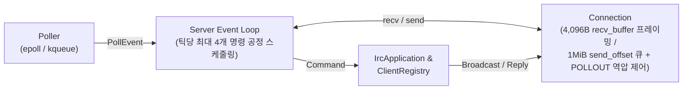

<p align="center">
  <h1 align="center">irc-relay-server</h1>
  <p align="center"><b>단일 프로세스에서 논블로킹 TCP 연결을 다중화해 클라이언트 등록, 개인 메시지, 채널 메시지를 중계하는 C++17 IRC 서버</b></p>
  <p align="center">
    
    
  </p>
</p>

42 `ft_irc` 과제를 변형한 C++17 프로젝트입니다. 단일 프로세스에서 논블로킹 TCP 연결을 다중화해 IRC 클라이언트의 등록, 개인 메시지, 채널 메시지를 중계합니다.

## 아키텍처와 핵심 설계



- **2계층 `Poller` 추상화(`epoll` / `kqueue`)**: OS별 멀티플렉서 차이를 `Poller` 인터페이스로 격리해 Linux에서는 `epoll`, macOS에서는 `kqueue` 백엔드를 선택하며, 상위 `Server` 루프는 동일한 `PollEvent`(`readable`, `writable`, `error`, `hangup`) 집합만 소비합니다.
- **TCP 바이트 스트림 프레이밍과 입력 버퍼 상한**: `recv()`가 반환한 바이트 조각을 연결별 `recv_buffer`에 누적하고 `\r\n` 경계로 완전한 명령만 분리합니다. 개행 없이 누적된 버퍼가 `4,096B`를 넘으면 `OOM` 방어를 위해 연결을 즉시 종료하고, 완성된 한 줄이 RFC 2812 규격(`512B`)을 초과하면 `417 ERR_INPUTTOOLONG`을 응답한 뒤 해당 라인만 폐기합니다.
- **송신 오프셋 큐와 Slow Consumer 백프레셔**: 브로드캐스트 시 수신자의 커널 송신 버퍼가 가득 차 `send()`가 `EAGAIN`을 반환하더라도 이벤트 루프를 블로킹하지 않고 연결별 `send_buffer`와 `send_offset`에 잔여 바이트를 유지한 채 해당 소켓의 `POLLOUT` 감시만 동적으로 켭니다. 미전송 큐가 `--max-pending-bytes`(기본 `1MiB`)를 초과하면 해당 연결만 정리합니다.
- **틱당 명령 처리 예산(`max_commands_per_tick`)과 공정성**: 단일 클라이언트가 대량의 명령 파이프라인을 한 번에 보낼 때 다른 연결이 기아(Starvation) 상태에 빠지지 않도록 한 이벤트 루프 틱당 연결별 최대 4개 명령만 처리하고 다음 소켓으로 순서를 넘깁니다.

## 빌드

```sh
make
```

산출물은 `build/bin/irc-relay-server`입니다. 이벤트 백엔드는 Linux에서 `epoll`, macOS에서 `kqueue`로 정해집니다.

## 실행

```sh
./build/bin/irc-relay-server 6667 relay-secret --rate-limit=24:3 --max-pending-bytes=1048576
```

첫 두 인자는 포트(1-65535)와 접속 비밀번호입니다. 옵션은 `--idle-timeout=N`(기본 120), `--ping-timeout=N`(기본 30), `--registration-timeout=N`(기본 30), `--rate-limit=COUNT:SECONDS`(기본 `24:3`), `--max-pending-bytes=N`(기본 1048576), `--max-connections=N`(기본 256)이며 시간 단위는 초입니다.

## 테스트

```sh
make test
```

- `make connection-test`, `make unit`, `make application-test`: 연결, 서버 수명, 애플리케이션 수명 단위 테스트를 하나씩 실행합니다.
- `make event-test`: 동시 연결 160개로 이벤트 공정성을 검사합니다. `make test`의 스모크와 이 타깃은 `python3`가 필요합니다.

## 범위와 제한

- 처리하는 명령은 `PASS`, `NICK`, `USER`, `PING`, `PONG`, `QUIT`, `PRIVMSG`, `JOIN`, `PART`, `TOPIC`, `KICK`, `INVITE`, `MODE`, `LIST`, `NAMES`와 서버 통계용 `METRICS`입니다. 클라이언트가 보낸 `NOTICE`는 `421`로 거절합니다.
- 채널 모드는 `i`, `t`, `o`만 지원합니다. `k`(채널 키)와 `l`(인원 제한)은 `472`로 거절합니다.
- `0.0.0.0`에 IPv4로만 listen합니다. TLS와 서버 간 연결은 없습니다.
- Linux와 macOS 외의 OS에서는 Makefile이 빌드를 거부합니다.
